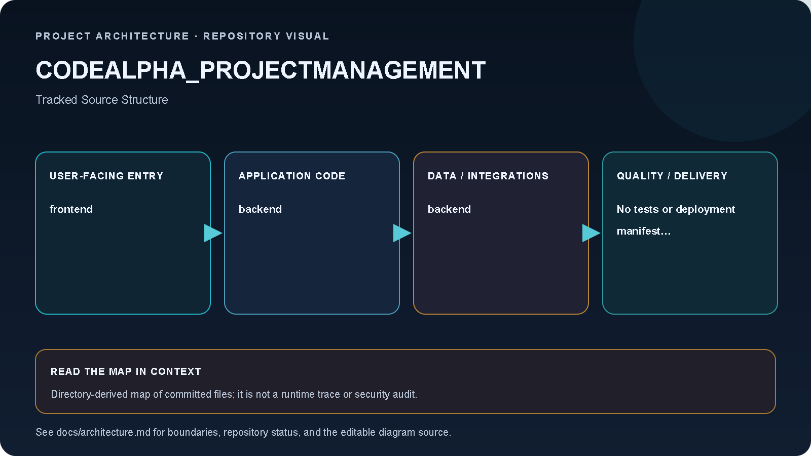
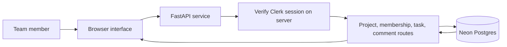

# CodeAlpha Project Management

<strong>A project and task-management prototype with a FastAPI backend, team membership, tasks, and comments.</strong>

**Live link:** [https://ca-project-mgmt.vercel.app/login](https://ca-project-mgmt.vercel.app/login)

Python · FastAPI · Clerk · Neon Postgres · HTML/CSS/JavaScript

## Project overview

Clerk authenticates users, while Neon stores projects, memberships, tasks, and comments. The interface supports private projects, shared team access, task status, priority, assignees, and comments. The repository includes a browser UI, screenshots, and a recorded demo.

## Architecture

[Architecture notes](docs/architecture.md) · [Editable SVG](docs/images/codealpha-projectmanagement-architecture.svg)

## Configure and run

Install `backend/requirements.txt`, copy `backend/.env.example` into the server environment, configure Clerk and Neon, and apply `backend/migrations/0001_clerk_neon.sql` to Neon before startup. Keep `CLERK_SECRET_KEY`, optional `CLERK_JWT_KEY`, and `DATABASE_URL` server-side. The public publishable Clerk key is returned by `/api/public-config` for the browser. Set exact origins in `CORS_ORIGINS` and `CLERK_AUTHORIZED_PARTIES`.

Build the container from the repository root with `docker build -f backend/Dockerfile -t codealpha-project-management .`; it exposes port `7860`. Local tests may use SQLite; production uses Neon.

Protected API routes validate Clerk session tokens on the server and check project membership before reading or changing project data. No R2 bucket is added because this project has no file upload or generated-media workflow.

Run backend tests with `python -m pip install -r backend/requirements-dev.txt` and `python -m pytest -q backend/tests`.

## Project media

- [Recorded demo](httpsca-project-mgmt.vercel.applogin.mp4)
- [Interface capture](httpsca-project-mgmt.vercel.applogin.png)

## Project structure

- `backend/app/main.py` — FastAPI routes
- `backend/app/auth.py` — Clerk session verification
- `backend/app/database.py` — SQLAlchemy engine and local SQLite test setup
- `backend/migrations/0001_clerk_neon.sql` — Neon schema and indexes
- `backend/requirements.txt` — Python dependencies
- `backend/Dockerfile` — container recipe
- `frontend/index.html` — browser interface
