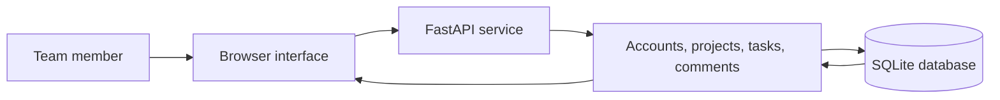

# CodeAlpha Project Management

<strong>A project and task-management prototype with a FastAPI backend, relational records, and a browser interface.</strong>

Python · FastAPI · SQLite · HTML/CSS/JavaScript

## Project overview

The backend in `backend/app/main.py` defines registration/login, project membership, tasks, and task comments, backed by SQLite tables. The repository includes a frontend entry page, screenshots, and a recorded deployment demo.

## Architecture

## Run and deployment status

Python dependencies are listed in `backend/requirements.txt`; build the Docker image from the repository root with `docker build -f backend/Dockerfile -t codealpha-project-management .`. The container exposes port `7860`; mount persistent writable storage at `/data` or set `APP_DATA_DIR`.

The current backend uses salted PBKDF2 password hashes, bearer headers, project membership checks, input bounds, and configurable CORS (`CORS_ORIGINS`). Set `APP_DATA_DIR` to a persistent writable directory. Legacy SHA-256 password hashes are upgraded after a successful login.

This remains a learning prototype, not a production team workspace: bearer tokens are held in process memory and are lost on restart, and SQLite is not configured for multi-instance production use. Review deployment secrets, rate limiting, durable sessions, database migrations, and operational backup/restore before exposing it to real users.

Run backend security tests from the repository root with `python -m pip install -r backend/requirements-dev.txt` and `python -m pytest -q backend/tests`.

## Project media

- [Recorded demo](httpsca-project-mgmt.vercel.applogin.mp4)
- [Interface capture](httpsca-project-mgmt.vercel.applogin.png)

## Project structure

- `backend/app/main.py` — FastAPI routes and SQLite setup
- `backend/requirements.txt` — Python packages
- `backend/Dockerfile` — container recipe
- `frontend/index.html` — browser interface entry page
